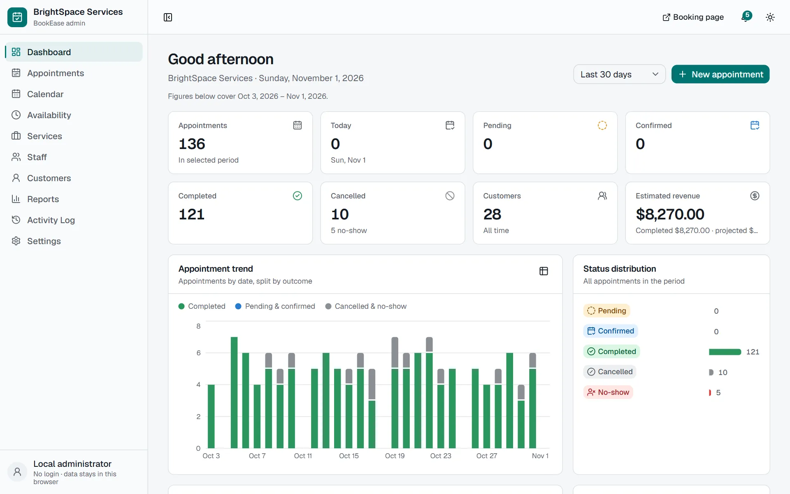
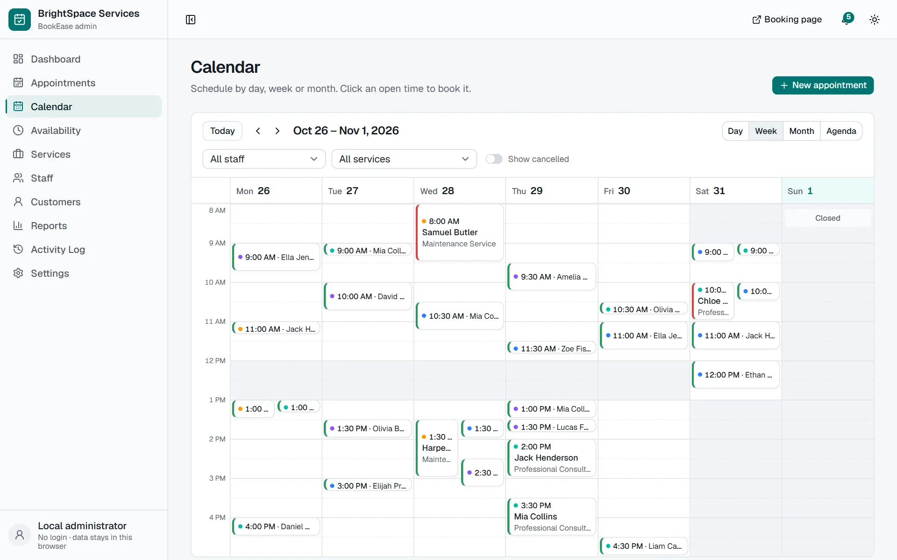
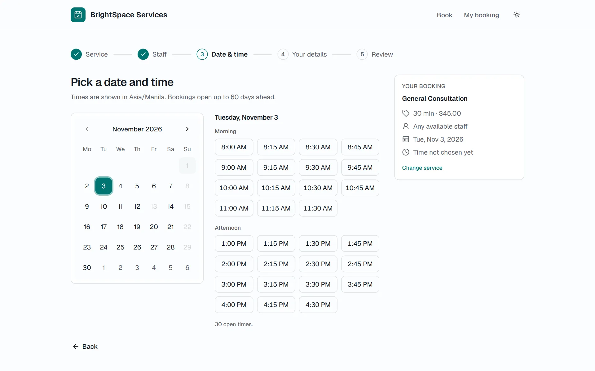

# BookEase

Appointment and booking management for service businesses (salons, consultancies, repair
shops, studios), built as a single-page React app that runs **entirely in the browser**. An
admin workspace runs the schedule; a customer portal takes bookings. Everything is stored
locally in IndexedDB: no server, no account, no external services.

**Live site:** https://bookease-ruby.vercel.app (choose *Explore with sample data* on first
visit; the data stays in your browser).

<picture>
  <source media="(prefers-color-scheme: dark)" srcset="docs/screenshot-dashboard-dark.webp">
  
</picture>

<p>
  
  
</p>

More: [appointments](docs/screenshot-appointments.webp) ·
[reports](docs/screenshot-reports.webp) · dark mode
([dashboard](docs/screenshot-dashboard-dark.webp), [calendar](docs/screenshot-calendar-dark.webp),
[appointments](docs/screenshot-appointments-dark.webp)).

## Features

- **Scheduling engine**: available slots from business hours, staff schedules, breaks,
  holidays, closures, special hours, staff leave, service duration, buffer time, booking
  notice and existing bookings. Conflicts use the half-open interval rule.
- **Appointments**: create, edit, reschedule, confirm, complete, mark no-show, cancel with a
  reason; enforced status transitions; search, filters, sorting, pagination, CSV/JSON export.
- **Calendar**: day (per staff column), week, month and agenda views; staff and service
  filters; click an open time to book it.
- **Services, staff, customers**: categories, active/inactive, any-staff vs assigned-staff
  services, staff working hours and leave, customer profiles with history and duplicate-email
  protection. Appointments keep a snapshot of names, prices and durations.
- **Customer portal**: service → staff → date & time → details → review → confirmation, with
  print, `.ics` and text downloads, booking lookup and self-service cancellation.
- **Dashboard and reports**: KPIs, trends, status mix, popular services, completed vs
  projected revenue, staff and customer reports; CSV, JSON and print.
- **Notifications and activity log**: locally generated; nothing is emailed or texted.
- **Settings**: business details and logo, timezone, currency, booking rules, light/dark/system
  theme, JSON backup and restore, sample data load/clear, full reset.

The complete list, with business rules, is in [docs/FEATURES.md](docs/FEATURES.md).

## Tech stack

React 19 · TypeScript · Vite · Tailwind CSS 4 · shadcn/ui (Radix) · React Router · Zustand ·
React Hook Form + Zod · Dexie (IndexedDB) · Recharts · date-fns · Lucide · Vitest + React
Testing Library · Playwright · Docker · Vercel.

## Architecture in one paragraph

Pages read data through repository functions wrapped in `useLiveQuery` (so every view updates
when IndexedDB changes, even from another tab) and write only through service modules. Services
re-validate input with the same Zod schemas the forms use, run the pure scheduling engine, and
save the record, its activity entry and its notification in one IndexedDB transaction. Details,
diagrams and the database schema are in [docs/ARCHITECTURE.md](docs/ARCHITECTURE.md).

```
src/
  app/          router, layouts, providers
  components/   ui (shadcn), shared (DataTable, DatePicker, TimeSlotPicker...), feedback
  features/     dashboard, appointments, calendar, availability, services, staff,
                customers, booking, reports, notifications, activity, settings
  database/     Dexie schema, migrations, repositories, demo seed
  services/     business logic (scheduling engine, appointments, booking, reports, backup...)
  validation/   Zod schemas    store/  Zustand    lib/  time, money, csv, ids
tests/          unit, integration (fake-indexeddb), component, e2e (Playwright)
```

## Getting started

Requires Node 22 or newer.

```bash
npm install
npm run dev        # http://localhost:5173
```

On first launch choose **Explore with sample data** (a demo business, "BrightSpace Services",
with appointments around today's date) or **Start with an empty business**.

| Command | What it does |
| --- | --- |
| `npm run dev` | Development server with hot reload |
| `npm run build` | Typecheck and build the static site into `dist/` |
| `npm run preview` | Serve the production build on port 4173 |
| `npm run typecheck` | TypeScript project check |
| `npm run lint` | ESLint |
| `npm test` | Unit, integration and component tests (Vitest) |
| `npm run test:e2e` | End-to-end tests against the production build (Playwright, Edge channel; `PW_CHANNEL=` to use bundled Chromium after `npx playwright install chromium`) |
| `npm run check` | Typecheck + lint + tests + build |

## Docker

Docker is for local development only; production is static hosting.

```bash
docker compose up --build                      # dev server: http://localhost:5173
docker compose down                            # stop
docker compose build --no-cache app            # rebuild the image
docker compose exec app npm test               # tests inside the running container
docker compose exec app npm run lint
docker compose exec app npm run typecheck
docker compose exec app npm run build          # production build into dist/
docker compose --profile prod up --build preview   # production build served on :4173
```

Source is bind-mounted and the dev server polls for changes, so edits on Windows or macOS
hot-reload inside the container. There is no database container: the database lives in the
browser.

## Testing

- **Unit** (`tests/unit`): time helpers, interval maths, conflict rule, slot generation (hours,
  breaks, closures, special hours, leave, notice, advance window, buffers, adjacency, cancelled
  slots, staff pools), status transitions, references, phone normalisation.
- **Integration** (`tests/integration`, fake-indexeddb): appointment lifecycle, duplicate and
  conflict prevention, customer booking and cancellation, database migration v1 → v2, demo seed
  idempotency, clear-sample-data, backup round trip, import validation and transaction rollback.
- **Component** (`tests/component`): every admin module and the booking flow with React Testing
  Library and user-event.
- **End to end** (`tests/e2e`): a full portal booking found again in lookup and in the admin,
  direct loads and refreshes of nested routes, back/forward, 404s, no requests to other origins,
  and no sideways scrolling on a phone.

## Deployment

Vercel, as a static Vite site: build `npm run build`, output `dist`, no environment variables.
`vercel.json` adds the SPA fallback, long-term caching for hashed assets and a strict
Content-Security-Policy. Step-by-step guide: [docs/DEPLOYMENT.md](docs/DEPLOYMENT.md).

## Data and known limitations

BookEase is deliberately browser-only, and it says so in the app:

- Data lives in **this browser profile**. Another device, browser or private window starts
  empty. The admin and the booking portal share the same local data; a booking is not sent to
  any business, and no email or SMS is sent.
- No protection against two **devices** booking the same slot (there is no shared server).
  Within one browser, IndexedDB transactions serialise writes across tabs and availability is
  recomputed inside the save transaction.
- No authentication: the admin is an open local workspace, not a secured back office.
- Browsers can evict or clear site data. BookEase asks for persistent storage and offers JSON
  backup and restore in Settings → Data.
- One business timezone; a DST transition hour is treated like any other hour.

## Status

Live at **https://bookease-ruby.vercel.app** (a static build on Vercel). Shown on the portfolio
at https://jmcastillo-portfolio.vercel.app/projects/bookease/. Plan and progress:
[`docs/PROJECT_PROGRESS.md`](docs/PROJECT_PROGRESS.md); design:
[`docs/ARCHITECTURE.md`](docs/ARCHITECTURE.md); all features:
[`docs/FEATURES.md`](docs/FEATURES.md); hosting: [`docs/DEPLOYMENT.md`](docs/DEPLOYMENT.md);
changes: [`docs/CHANGELOG.md`](docs/CHANGELOG.md).
